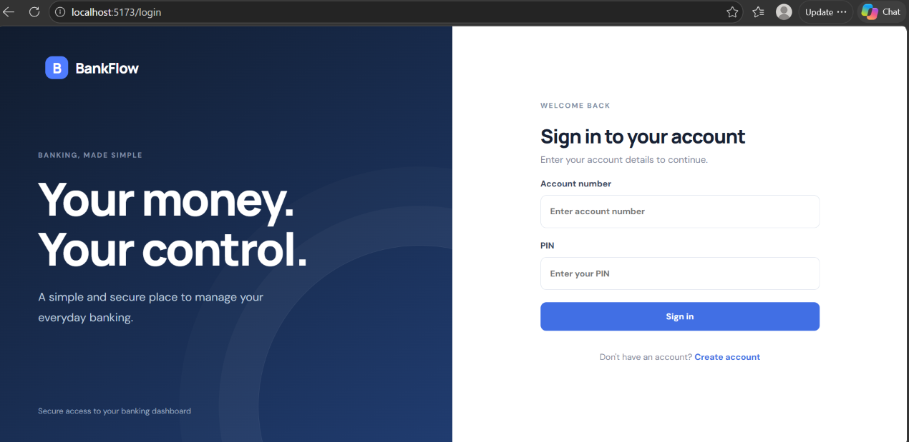
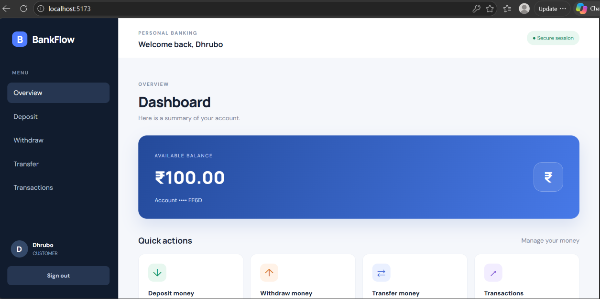
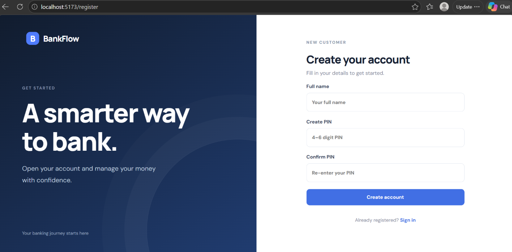

# Banking System — Full-Stack Banking Application

A full-stack banking application built with **Java 21, Spring Boot 3.5.x, Spring Security, JWT, React, TypeScript, and MySQL**. It demonstrates REST API development, authentication, relational persistence, and frontend/backend integration.

> **Accuracy note:** Verify every endpoint and workflow against your current source code before publishing. Items in Future Improvements are proposals, not completed features.

## Table of Contents

- [Overview](#overview)
- [Features](#features)
- [Technology Stack](#technology-stack)
- [Architecture](#architecture)
- [Project Structure](#project-structure)
- [Run Locally](#run-locally)
- [Configuration](#configuration)
- [API Overview](#api-overview)
- [Database](#database)
- [Security](#security)
- [Screenshots](#screenshots)
- [Testing](#testing)
- [Future Improvements](#future-improvements)

## Overview

The Banking System provides a React web interface backed by a Spring Boot REST API. The backend uses a layered structure to separate controllers, business logic, persistence, and security. The frontend uses React and TypeScript, Axios for HTTP communication, and React Router for navigation.

## Features

### Authentication and security

- Customer registration and login.
- JWT-based stateless authentication.
- BCrypt hashing for customer PINs.
- Spring Security endpoint authorization.
- ADMIN and CUSTOMER role model.
- CORS configuration for the local React development server.

### Banking workflows

The project includes account and transaction domain components. Confirm that each workflow is fully implemented and tested before claiming it as complete:

- Account balance retrieval.
- Deposit and withdrawal.
- Transfers between accounts.
- Transaction history.

### Frontend

- React and TypeScript application.
- Login and registration screens.
- Authentication context and session state.
- Protected routes.
- Axios API client and banking workflow pages.

## Technology Stack

| Area            | Technology                   |
| --------------- | ---------------------------- |
| Language        | Java 21, TypeScript          |
| Backend         | Spring Boot 3.5.x            |
| Security        | Spring Security, JWT, BCrypt |
| Persistence     | Spring Data JPA, Hibernate   |
| Database        | MySQL 8                      |
| Frontend        | React 18, Vite               |
| HTTP client     | Axios                        |
| Routing         | React Router                 |
| Build tools     | Maven, npm                   |
| API testing     | Postman                      |
| Version control | Git, GitHub                  |

## Architecture

```text
+------------------------------+
|       React + TypeScript     |
| Pages / Components / Context |
+---------------+--------------+
                | HTTP + JSON
                | JWT Bearer token
                v
+------------------------------+
|        Spring Boot API       |
| Security -> Controllers      |
|          -> Services         |
|          -> Repositories     |
+---------------+--------------+
                | JPA / Hibernate
                v
+------------------------------+
|             MySQL            |
|      Accounts / Transactions |
+------------------------------+
```

See [docs/architecture.md](docs/architecture.md) for component responsibilities and request flows.

## Project Structure

Recommended repository layout:

```text
Banking-System/
├── backend/
│   └── BankingSystemAPI/
├── frontend/
│   └── banking-frontend/
├── docs/
│   ├── architecture.md
│   └── database-design.md
├── screenshots/
├── .gitignore
└── README.md
```

Adjust folder names to match your actual repository.

## Run Locally

### Prerequisites

- JDK 21
- Maven (or Maven Wrapper)
- Node.js and npm
- MySQL 8
- Git

### 1. Clone

```bash
git clone https://github.com/dhrubojyoti13/Banking-System-with-SpringBootandReact.git
cd Banking-System
```

### 2. Create the database

```sql
CREATE DATABASE banking_system_api;
```

Create a dedicated local database user and grant it access. Do not commit credentials.

### 3. Start the backend

```bash
cd backend/BankingSystemAPI
mvn spring-boot:run
```

Expected backend URL: `http://localhost:8081`

### 4. Start the frontend

In a second terminal:

```bash
cd frontend/banking-frontend
npm install
npm run dev
```

Expected frontend URL: `http://localhost:5173`

## Configuration

Example `application.properties`:

```properties
spring.application.name=BankingSystemAPI
server.port=8081

spring.datasource.url=jdbc:mysql://localhost:3306/banking_system_api
spring.datasource.username=${DB_USERNAME}
spring.datasource.password=${DB_PASSWORD}

spring.jpa.hibernate.ddl-auto=update
spring.jpa.show-sql=true
spring.jpa.properties.hibernate.format_sql=true
spring.jpa.open-in-view=false

jwt.secret=${JWT_SECRET}
jwt.expiration=86400000
```

Set these environment variables locally or through your IDE run configuration:

```text
DB_USERNAME=your_local_database_user
DB_PASSWORD=your_local_database_password
JWT_SECRET=your_long_random_secret
```

Never commit passwords, JWT secrets, API keys, or real customer data. For production, use a secrets manager and versioned database migrations instead of relying on `ddl-auto=update`.

Check `frontend/.../src/services/api.ts` for the configured API base URL. If using Vite environment variables, a common name is `VITE_API_BASE_URL`.

## API Overview

Base URL: `http://localhost:8081`

The following routes reflect the project API plan/context. Verify exact mappings and HTTP methods in your controllers before publishing.

| Method | Endpoint                    | Purpose                      |
| ------ | --------------------------- | ---------------------------- |
| POST   | `/api/auth/register`        | Register a customer          |
| POST   | `/api/auth/login`           | Authenticate a customer      |
| GET    | `/api/accounts/balance`     | Retrieve account balance     |
| POST   | `/api/accounts/deposit`     | Deposit funds                |
| POST   | `/api/accounts/withdraw`    | Withdraw funds               |
| POST   | `/api/accounts/transfer`    | Transfer funds               |
| GET    | `/api/transactions/history` | Retrieve transaction history |

Protected requests use:

```http
Authorization: Bearer <JWT_TOKEN>
```

Registration example:

```json
{
  "fullName": "Test Customer",
  "pin": "1234"
}
```

Login example:

```json
{
  "accountNumber": "YOUR_ACCOUNT_NUMBER",
  "pin": "1234"
}
```

Use synthetic data only in public examples and screenshots.

## Database

Known domain entities:

- **Account:** account number, customer name, PIN hash, balance, role, status, and creation timestamp.
- **Transaction:** account number, related account, amount, transaction type, description, and creation timestamp.

See [docs/database-design.md](docs/database-design.md). Exact SQL types, constraints, indexes, and foreign keys must be checked against your entity annotations and actual MySQL schema.

## Security

Current security concepts include JWT authentication, BCrypt PIN hashing, stateless Spring Security configuration, role-based authorization, and CORS for the configured frontend origin.

Before deployment, review token revocation, rate limiting, input validation, audit logging, TLS, secret storage, and account-level authorization. This learning project should not be used to handle real customer funds or personal financial data.

## Screenshots

Add genuine screenshots under `screenshots/`, then update the paths below:

```text
screenshots/
├── login.png
├── register.png
├── dashboard.png
└── transactions.png
```

```md


```
<p align="center">
  
  
  
</p>


## Testing

Document only tests that exist in the repository. Recommended coverage:

- JUnit 5 and Mockito service unit tests.
- MockMvc controller/API tests.
- Repository integration tests.
- Testcontainers with MySQL.
- Frontend component/API tests.
- End-to-end tests for customer workflows.

## Future Improvements

- Use `BigDecimal` and SQL `DECIMAL` for monetary values.
- Apply `@Transactional` to multi-step financial operations.
- Add locking and concurrency tests to prevent lost updates and overdrafts.
- Add idempotency keys for retry-safe transfers.
- Introduce a double-entry ledger.
- Add validation and centralized exception responses.
- Add pagination, sorting, and filtering to transaction history.
- Add audit trails and security-event logging.
- Add refresh-token rotation and revocation.
- Add OpenAPI/Swagger documentation.
- Add JUnit, Mockito, MockMvc, and Testcontainers coverage.
- Add Docker Compose and GitHub Actions CI.
- Deploy with monitoring, backups, and managed secrets.

## Contributing

1. Fork the repository.
2. Create a feature branch: `git checkout -b feature/your-feature`.
3. Make and test your changes.
4. Commit: `git commit -m "Add your feature"`.
5. Push the branch and open a Pull Request.

## License

Choose a license before publishing. If you choose MIT, add the full MIT License text in a root-level `LICENSE` file.

---

**Built as a full-stack software engineering project with Java, Spring Boot, React, TypeScript, and MySQL.**
